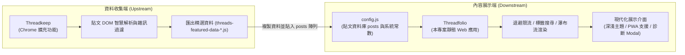
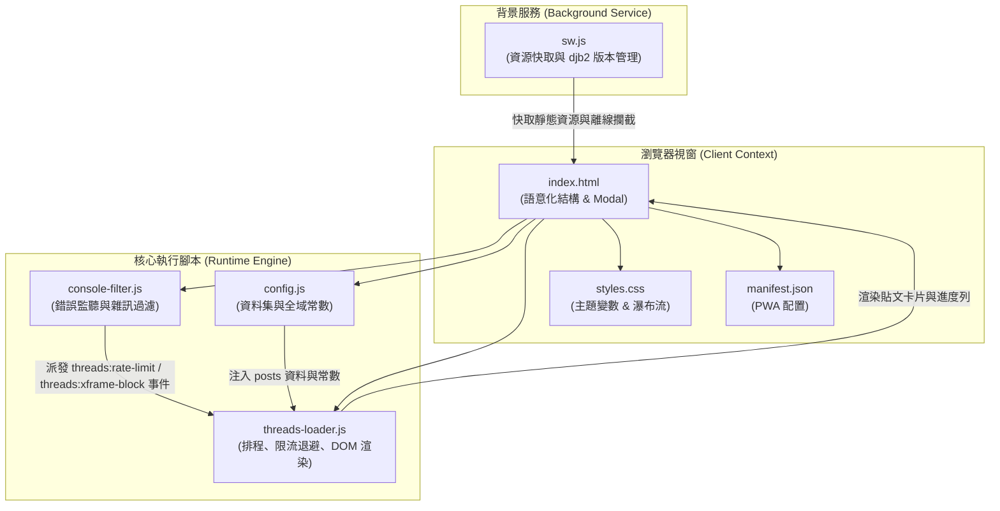
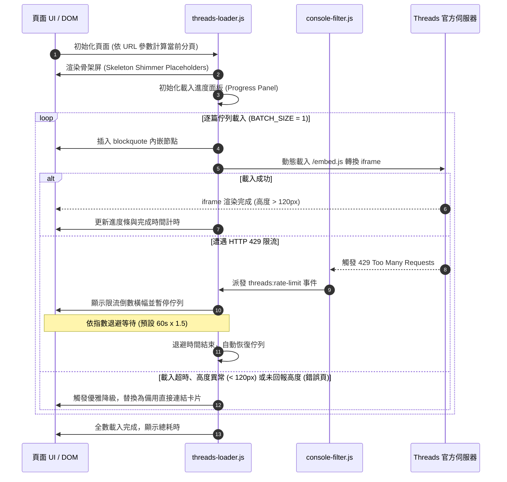

<div align="center">

# Threadfolio

**基於純前端技術的精選 Threads 貼文展示、多欄瀑布流排版與智慧限流防護網頁應用**

[](./LICENSE)
[](./manifest.json)
[](#系統規格與技術棧)
[](#系統規格與技術棧)
[](https://github.com/Scorpio-meow/Threadkeep)

---

[English](./README_EN.md) | 繁體中文

純前端原生架構、零外部框架依賴、開箱即用。  
具備 HTTP 429 速率限制指數退避、Iframe 渲染異常監控與優雅降級、確定性種子隨機排序，  
並結合 Progressive Web App (PWA) 離線快取技術，提供極致流暢的技術貼文瀏覽與檢索體驗。

</div>

---

## 目錄

- [專案簡介與核心價值](#專案簡介與核心價值)
- [生態系與專案關聯](#生態系與專案關聯)
- [快速開始](#快速開始)
  - [前置條件與環境需求](#前置條件與環境需求)
  - [1. 下載專案](#1-下載專案)
  - [2. 配置貼文資料](#2-配置貼文資料)
  - [3. 啟動本機開發伺服器](#3-啟動本機開發伺服器)
- [核心功能特性](#核心功能特性)
  - [1. 智慧搜尋與標籤即時篩選](#1-智慧搜尋與標籤即時篩選)
  - [2. 雙主題系統與 CSS 設計變數](#2-雙主題系統與-css-設計變數)
  - [3. 響應式瀑布流與單欄版面切換](#3-響應式瀑布流與單欄版面切換)
  - [4. 自動限流偵測與指數退避保護](#4-自動限流偵測與指數退避保護)
  - [5. 分塊非阻塞渲染與骨架屏微光動畫](#5-分塊非阻塞渲染與骨架屏微光動畫)
  - [6. 確定性種子隨機排序](#6-確定性種子隨機排序)
  - [7. PWA 支援與 32-bit djb2 內容雜湊快取](#7-pwa-支援與-32-bit-djb2-內容雜湊快取)
  - [8. Iframe 存活監控、背景分頁適配與優雅降級](#8-iframe-存活監控背景分頁適配與優雅降級)
  - [9. 單篇貼文隔離預覽模式](#9-單篇貼文隔離預覽模式)
  - [10. 即時載入進度面板](#10-即時載入進度面板)
  - [11. 全域 Console 雜訊過濾機制](#11-全域-console-雜訊過濾機制)
  - [12. 常見問題與除錯手風琴對話框](#12-常見問題與除錯手風琴對話框)
- [系統規格與技術棧](#系統規格與技術棧)
- [專案目錄與檔案結構](#專案目錄與檔案結構)
  - [檔案目錄清單](#檔案目錄清單)
  - [模組職責對照表](#模組職責對照表)
- [系統架構與流程圖](#系統架構與流程圖)
  - [系統模組架構圖](#系統模組架構圖)
  - [貼文載入與限流生命週期時序圖](#貼文載入與限流生命週期時序圖)
- [系統配置與資料規範](#系統配置與資料規範)
  - [執行期常數設定表 (RuntimeConfig)](#執行期常數設定表-runtimeconfig)
  - [貼文資料結構 (PostItem)](#貼文資料結構-postitem)
  - [URL 查詢參數規格表 (URLParams)](#url-查詢參數規格表-urlparams)
- [核心演算法與技術實作剖析](#核心演算法與技術實作剖析)
  - [1. 指數退避限流演算法 (Exponential Backoff)](#1-指數退避限流演算法-exponential-backoff)
  - [2. 32-bit djb2 內容雜湊快取比對機制](#2-32-bit-djb2-內容雜湊快取比對機制)
  - [3. 確定性偽隨機洗牌演算法 (Seeded Shuffle)](#3-確定性偽隨機洗牌演算法-seeded-shuffle)
  - [4. Iframe 雙重觀察器與降級替換機制](#4-iframe-雙重觀察器與降級替換機制)
- [常見問題與疑難排解 (FAQ)](#常見問題與疑難排解-faq)
- [開發與部署指南](#開發與部署指南)
  - [本地開發指令](#本地開發指令)
  - [靜態託管部署](#靜態託管部署)
- [版本更新紀錄 (Changelog)](#版本更新紀錄-changelog)
- [AI 友善文件說明 (llms.txt)](#ai-友善文件說明-llmstxt)
- [授權條款與免責聲明](#授權條款與免責聲明)

---

## 專案簡介與核心價值

Threads 平台的官方嵌入卡片具備極高的動態性與社群互動性，但在大量引用展示時，經常面臨跨網域驗證失敗、HTTP 429 速率限制（Too Many Requests）、頁面主線程卡頓與排版崩塌等問題。

本專案「**Threadfolio**」是一套針對上述痛點所打造的現代化靜態展示解決方案：

| 核心價值 | 說明 |
| :--- | :--- |
| **高度穩定限流防護** | 全域攔截 429 限流錯誤，以指數退避安全暫停佇列並以倒數計時器自動恢復，徹底解決頁面載入中斷問題。 |
| **優雅降級容錯保證** | 當貼文無法渲染或高度異常（低於 120px）時，自動切換為備用作者卡片與直達按鈕，避免畫面留白破版。 |
| **流暢分塊渲染** | 採用 requestIdleCallback 與 Shimmer 微光骨架屏，貼文依序平滑掛載，大幅優化 INP 與使用者互動體驗。 |
| **極速檢索與篩選** | 支援即時關鍵字模糊搜尋、熱門標籤頻次排序與展開切換，篩選狀態與 URL 參數即時雙向綁定。 |
| **離線快取與 PWA** | 透過 djb2 內容雜湊自動比對版本更新，支援桌面與行動裝置安裝至主畫面以獨立視窗離線運作。 |

---

## 生態系與專案關聯

本專案作為「**內容展示端 (Downstream)**」，與資料收集擴充功能 **[Threadkeep](https://github.com/Scorpio-meow/Threadkeep)** 緊密協同運作：



1. **資料收集端**：使用 [Threadkeep](https://github.com/Scorpio-meow/Threadkeep) 在瀏覽 Threads 時一鍵儲存優質內容，點擊「匯出精選資料」產出無 `@` 前綴的結構化配置檔。
2. **內容展示端**：將匯出內容貼入本專案的 [config.js](./config.js) 之中，即可直接上線兼具限流保護、即時檢索與瀑布流美感之精選網站。

---

## 快速開始

### 前置條件與環境需求

- 支援現代標準之瀏覽器（Chrome, Edge, Safari, Firefox, Brave, Arc 等）。
- 靜態檔案伺服器環境（支援 Bun、Node.js、Python 或任何靜態託管平台）。
- 無需編譯建置、無需打包工具、無 npm 執行期相依套件。

### 1. 下載專案

```bash
git clone https://github.com/Scorpio-meow/Threadfolio-Example.git
cd Threadfolio-Example
```

### 2. 配置貼文資料

開啟 [config.js](./config.js)，將貼文資料填入 `posts` 陣列中：

```javascript
const posts = [
    {
        embedCode: '<blockquote class="text-post-media" data-text-post-permalink="https://www.threads.com/@username/post/xxx">...</blockquote>',
        postLink: 'https://www.threads.com/@username/post/xxx',
        author: 'username',
        content: '貼文純文字內容...',
        tags: ['JavaScript', 'WebDev']
    }
];
```

### 3. 啟動本機開發伺服器

可選擇以下任一種方式啟動本機伺服器以預覽專案：

**方式 A：使用 VS Code / IDE 的「Live Server」擴充功能（最簡便）**
- 安裝「Live Server」擴充功能。
- 在 `index.html` 上按右鍵，選擇「**Open with Live Server**」（預設開啟 `http://127.0.0.1:5500`）。

**方式 B：使用 Bun 啟動（終端機指令推薦）**
```bash
bunx http-server -p 3000
```
啟動後於瀏覽器開啟 `http://localhost:3000` 即可預覽。

**方式 C：使用 Python 啟動（備用方案）**
```bash
python -m http.server 3000
```

---

## 核心功能特性

### 1. 智慧搜尋與標籤即時篩選
- **即時模糊搜尋**：輸入關鍵字即時比對發文者帳號、貼文內文純文字以及所屬 Hashtag。
- **熱門標籤頻次排序**：系統自動統計所有貼文中出現的標籤次數並按降序排列，支援「展開 / 收起」超過預設數量的標籤。
- **雙向 URL 狀態綁定**：搜尋關鍵字 (`?search=`) 與選取標籤 (`?tag=`) 自動寫入網址列，支援直接複製網址分享或加入書籤。

### 2. 雙主題系統與 CSS 設計變數
- **深色 / 淺色主題切換**：頂部提供一鍵主題切換按鈕，使用者偏好自動儲存至 `localStorage`。
- **Threads 原生卡片主題同步**：貼文卡片渲染時，會把目前主題寫入嵌入碼 `blockquote` 的 `data-theme`，讓官方嵌入卡片跟網站同色；切換主題後，已載入的卡片要換頁或重新整理才會跟著換色。
- **全套 CSS Custom Properties**：色彩、字重、圓角、緩動曲線等設計 Token 集中於 `styles.css`，易於客製化與擴充。
- **無邊框明度分層**：介面不畫邊框，改以 1%–3% 的明度差分出層次（淺色 `#f5f5f3` / `#fcfcfb`，深色 `#0b0b0a` / `#151515` / `#1a1a19` / `#20201e`），不使用純黑。
- **深色字重補償**：深色模式下所有字重降 40（例如 400 → 360），避免白字發脹；字型因此改載入 Manrope 與 Noto Sans TC 的可變字重。
- **互動細節**：輸入框聚焦以雙環 `box-shadow` 取代 outline；複製貼文連結後的勾勾以欠阻尼彈簧（剛度 380、阻尼 18）彈出，2.5 秒後自動淡回；數字一律 `tabular-nums` 等寬，內文以 `text-wrap: pretty` 避免孤字。
- **捲動進場動畫**：卡片捲進畫面時，以 CSS 捲動時間軸（`animation-timeline: view()`）淡入上移；不支援的瀏覽器（如 Firefox）與開啟「減少動態效果」的使用者維持一般進場。

### 3. 響應式瀑布流與單欄版面切換
- **單欄專注清單檢視（預設）**：預設以單欄置中清單呈現，適合深度閱讀與對照程式碼。
- **原生 CSS `columns` 瀑布流**：可在版面控制列一鍵切換。採用原生 CSS Multi-column 佈局（`columns: 340px`，容器最寬 1160px），避免傳統 JS 瀑布流計算重排引起的卡頓；欄數依可用寬度自動決定（最多 3 欄），螢幕寬度 576px 以下固定 1 欄。
- **偏好記憶**：版面選擇儲存於 `localStorage`（`layout` 鍵）。

### 4. 自動限流偵測與指數退避保護
- **HTTP 429 智能捕捉**：兩條偵測路徑：
  - `console-filter.js` 攔截 console 中含 429／rate limit／too many requests 的訊息，派發 `threads:rate-limit` 全域事件。
  - `threads-loader.js` 包裝 `window.fetch` 與 `XMLHttpRequest`，回應狀態為 429 時直接觸發退避，並優先採用回應標頭 `Retry-After` 指定的秒數。
- **動態倒數橫幅與暫停**：即時於載入進度面板彈出紅色警示橫幅，動態顯示剩餘退避等待秒數，並自動暫停後續佇列。
- **指數退避演算法**：等待時間為 `RATE_LIMIT_BACKOFF × 1.5^(連續錯誤次數 − 1)`（預設 60 秒起算，上限 300 秒），倒數完畢自動安全重啟佇列載入。

### 5. 分塊非阻塞渲染與骨架屏微光動畫
- **requestIdleCallback 排程**：在瀏覽器空閒時段進行 DOM 卡片節點掛載，徹底消除大量 DOM 同步操作導致的掉幀與輸入延遲。
- **Shimmer 微光骨架屏**：排隊中的貼文卡片疊上頭像、名稱、文字與圖片區塊的骨架（`.post-skeleton`）並帶流光動畫，蓋住 Threads 原始的白底佔位框；Threads 以 `postMessage` 回報高度後，卡片加上 `post-item--ready`，骨架淡出換成實際貼文。載入失敗的卡片直接換成備用卡片。

### 6. 確定性種子隨機排序
- **時間戳記種子隨機化**：點擊「隨機排序」按鈕時產生時間戳記種子並寫入 URL `?random=<seed>`。
- **跨頁與重新整理一致性**：依據該種子計算確定性偽隨機序列，確保使用者在翻頁或重新整理頁面時，文章順序維持完全一致。

### 7. PWA 支援與 32-bit djb2 內容雜湊快取
- **Progressive Web App**：具備完整的 `manifest.json` 與 Service Worker，支援在桌面端 (Chrome/Edge/Safari) 及行動端 (iOS/Android) 安裝為獨立應用。
- **djb2 內容雜湊自動更新**：Service Worker 讀取 6 個核心檔案源碼並計算 32-bit 雜湊值作為快取版號，當檔案有變更時自動淘汰舊快取並重新載入，無快取殘留困擾。

### 8. Iframe 存活監控、背景分頁適配與優雅降級
- **MutationObserver + ResizeObserver 雙重監控**：即時監控動態生成的 iframe 節點狀態與高度變化。
- **背景分頁載入適配與防塌陷機制**：
  - CSS 全域設定 `.post-item iframe { min-height: 280px; }` 作為取得實際高度前的占位高度（Threads `embed.js` 建立 iframe 時高度為 0），防止瀏覽器在背景凍結佈局時卡片塌陷成細條。
  - 自動過濾初始空白 `about:blank` 載入事件，確保僅在真實 Threads 貼文網址（`threads.com`/`threads.net`）加載後才進行驗證。
  - 背景模式（`document.hidden`）下自動延長超時判定至 25 秒以上；分頁切回前台（`visibilitychange`）時即時觸發 `window.resize` 廣播與尺寸重新測量。
  - 全域註冊 `postMessage` 訊息監聽器，接收 Threads iframe 以純數字回傳的內容高度（僅接受 `threads.com`/`threads.net` 來源，亦相容 `MEASURE`/`HEIGHT` 物件格式），將 iframe 的 `height` 與 `min-height` 同步為該高度，讓卡片貼合內容，並為所屬卡片加上 `post-item--ready` 以移除骨架屏；回報值為 0 時略過，避免塌陷。
- **自動降級替換**：若 iframe 載入超時（超過 `IFRAME_TIMEOUT`）、遭遇 `X-Frame-Options` 拒絕或高度低於 120px（官方阻擋狀態），系統會自動將其替換為備用卡片，顯示失敗原因與「在 Threads 上查看」直達按鈕。
- **錯誤頁偵測**：Threads 不開放嵌入的貼文（例如敏感內容或僅限登入查看），embed 端點會回 500 並顯示 Facebook「Sorry, something went wrong」頁面。判定規則：
  - 正常嵌入會由 Threads 以 `postMessage` 回報大於 0 的高度，錯誤頁則完全不回報；只有收到這個高度回報才算成功。
  - 其他訊息一律不算，包括瀏覽器擴充功能注入 iframe 後送出的自訂訊息（它們同樣來自 `threads.com`，不能當作 Threads 的訊號）。
  - 未回報時通常先由 `IFRAME_TIMEOUT` 判定逾時；若 `IFRAME_TIMEOUT` 設得較長，iframe 載入後 8 秒（`EMBED_REPORT_TIMEOUT`）內仍無回報也會判定失敗。
  - 計時只在前台進行；背景分頁先放行讓佇列繼續，切回前台後仍未回報才改判失敗。

### 9. 單篇貼文隔離預覽模式
- **URL 路由直達**：在網址列帶入 `?post=<URL>` 或 `?post=<Index>`，頁面將自動隱藏搜尋列、標籤列與分頁控制，僅專注呈現該篇貼文。
- **一鍵複製分享**：提供「複製分享連結」按鈕與「返回全部列表」快速導航。

### 10. 即時載入進度面板
- **即時指標監控**：即時顯示目前分頁貼文載入進度百分比，並提供 3 項核心時長指標：
  1. **預計載入下篇時間**：除遭遇 Meta 官方限流時顯示 60 秒退避冷卻倒數外，其餘一律固定以 3.6 秒精確倒數至 0 秒後發起下篇。
  2. **預計全部載入時間**：依據平均耗時與剩餘貼文數平滑預估。
  3. **全部載入完成用時**：載入期間即時跳動計時，全數完成後記錄總耗時。
- **等寬數字**：面板每 0.1 秒更新一次，數字以 `tabular-nums` 鎖定寬度，倒數時不會左右跳動。

### 11. 全域 Console 雜訊過濾機制
- **Console Filter 攔截器**：內建 `console-filter.js`，在非除錯模式下自動過濾 `cdninstagram.com` 的 404 資源錯誤、favicon 404 及 `threads.com` 的「Failed to load resource」錯誤，保持除錯主控台乾淨整潔。
- **事件轉送**：限流訊息派發 `threads:rate-limit`、`X-Frame-Options: deny` 拒絕訊息派發 `threads:xframe-block`，交由 `threads-loader.js` 處理；`?debug=1` 時這些訊息仍會照常輸出。

### 12. 常見問題與除錯手風琴對話框
- **頁尾 FAQ Modal**：整合折疊式常見問題診斷說明，包含貼文無法顯示的原因、速率限制對策等完整指引。
- **Grid 折疊動畫**：答案以 `grid-template-rows: 0fr → 1fr` 展開收合，不靠 JS 計算高度；收合時答案裡的連結與按鈕不會被 Tab 鍵選到。
- **一鍵開啟除錯模式**：提供按鈕一鍵為網址追加 `?debug=1`，即時輸出完整除錯日誌。

---

## 系統規格與技術棧

```
+-----------------------------------------------------------------------+
|                             技術架構標準                              |
+-----------------------------------------------------------------------+
|  核心技術    | 原生 HTML5, CSS3 Variables, Vanilla JavaScript (ES6+)   |
|  字體系統    | Google Fonts 可變字重 (Manrope, Noto Sans TC)          |
|  佈局引擎    | 原生 CSS Columns 瀑布流 + CSS Grid + Flexbox           |
|  離線快取    | Service Worker API (djb2 Content Hash 32-bit 自動比對) |
|  應用交付    | Progressive Web App (Web App Manifest) 支援主畫面安裝  |
|  依賴套件    | 0 External Dependencies (無 npm 執行期依賴、無外部框架)  |
|  託管相容    | 任意靜態 Web 伺服器 (GitHub Pages, Cloudflare, Vercel)  |
+-----------------------------------------------------------------------+
```

---

## 專案目錄與檔案結構

### 檔案目錄清單

```
Threadfolio-Example/
├── index.html            # 主頁面語意化 HTML (搜尋列、標籤容器、版面切換、FAQ Modal)
├── config.js             # 貼文資料集 (posts 陣列) 與執行期限流/渲染常數配置
├── threads-loader.js     # 核心調度腳本 (分頁、限流退避、DOM 渲染、標籤統計、進度面板)
├── console-filter.js     # 全域錯誤攔截器 (過濾 404 雜訊、捕捉 429 派發事件)
├── styles.css            # 設計 Token 系統 (CSS 變數、瀑布流、深淺主題、骨架屏、動畫)
├── sw.js                 # PWA Service Worker (djb2 雜湊自動快取失效、離線代理)
├── manifest.json         # PWA 清單設定檔 (名稱、圖示、展示模式、主題色彩)
├── assets/               # 靜態圖示資源目錄 (Favicon, PWA App Icons)
├── llms.txt              # AI 友善架構與 RAG 快速索引規範文件
├── README_EN.md          # 英文說明文件
└── README.md             # 專案中文說明文件 (本檔案)
```

### 模組職責對照表

| 檔案名稱 | 模組層級 | 主要職責與實作內容 |
| :--- | :--- | :--- |
| `index.html` | 視圖結構層 | 宣告現代語意化標籤、搜尋框、主題/版面控制項、分頁按鈕與常見問題對話框。 |
| `config.js` | 資料與配置層 | 集中存放貼文資料物件陣列與控制限流、延遲、分頁等 11 項關鍵系統參數。 |
| `threads-loader.js` | 核心控制層 | 負責 URL 路由解析、分頁計算、佇列排程、退避計時、DOM 分塊渲染與優雅降級。 |
| `console-filter.js` | 安全攔截層 | 攔截 Console 錯誤，過濾跨網域 404 雜訊，並在遭遇 HTTP 429 或 X-Frame-Options 拒絕時觸發全域事件。 |
| `styles.css` | 視覺樣式層 | 定義 CSS 自訂屬性、深淺主題、瀑布流排版、微光動畫與響應式斷點。 |
| `sw.js` | 背景快取層 | 透過 djb2 內容雜湊比對版本，快取必要靜態資產以支援離線使用與極速載入。 |
| `llms.txt` | 規範說明層 | 提供 AI 代理與 RAG 檢索系統快速索引之結構化摘要說明文件。 |

---

## 系統架構與流程圖

### 系統模組架構圖



### 貼文載入與限流生命週期時序圖



---

## 系統配置與資料規範

### 執行期常數設定表 (RuntimeConfig)

於 [config.js](./config.js) 可自訂下列核心運作常數：

| 配置常數名稱 | 類型 | 預設值 | 說明與安全最佳實踐 |
| :--- | :---: | :---: | :--- |
| `LOAD_DELAY` | number | `4000` | 基礎載入間隔延遲時間 (ms)。程式下限為 4000ms，設得更小會被提升為 4000ms。 |
| `BATCH_SIZE` | number | `1` | 單次併發載入 iframe 數量上限。程式固定上限為 1，設成大於 1 不會生效。 |
| `EMBED_STAGGER_DELAY` | number | `3600` | 相鄰貼文開始載入的間隔時間 (ms)。程式下限為 3600ms (3.6秒)，設得更小會被提升為 3600ms。 |
| `IFRAME_TIMEOUT` | number | `3600` | 單個 iframe 載入超時判定門檻 (ms)。超過此時間將執行降級。 |
| `MIN_IFRAME_TIMEOUT` | number | `8000` | 早期 iframe 存在性檢查的安全門檻時間 (ms)。 |
| `RATE_LIMIT_BACKOFF` | number | `60000` | 遭遇 429 速率限制時之基礎退避等待時間 (ms，每次觸發遞增 1.5 倍，上限 300 秒)。 |
| `MAX_DELAY` | number | `60000` | 動態調整延遲時間之最大上限 (ms)。 |
| `MIN_DELAY_BETWEEN_REQUESTS` | number | `3600` | 保留欄位，目前程式未讀取（相鄰請求間隔由 `EMBED_STAGGER_DELAY` 控制）。 |
| `MAX_VISIBLE_QUEUE` | number | `30` | 保留欄位，目前程式未讀取。 |
| `PAGE_SIZE_OPTIONS` | number[] | `[1, 5, 10, 25, 50, 100, 1000]` | 分頁下拉選單可選之每頁筆數陣列。 |
| `PAGE_SIZE` | number | `10` | 預設每頁顯示之貼文筆數。須為 `PAGE_SIZE_OPTIONS` 其中一項，否則改用選單第一項。 |

### 貼文資料結構 (PostItem)

[config.js](./config.js) 中的 `posts` 陣列元素支援標準物件定義：

```typescript
interface PostItem {
  /** 官方 blockquote HTML 內嵌代碼 */
  embedCode: string;

  /** Threads 原始貼文完整 URL */
  postLink: string;

  /** 發文者帳號 (不含 @ 前綴) */
  author: string;

  /** 貼文內文純文字 */
  content: string;

  /** 貼文所屬之 Hashtag 標籤陣列 */
  tags: string[];

  /** 未登入時能否嵌入（由擴充功能檢查後寫入）；false 時仍嘗試載入 iframe，失敗才顯示「只有登入者能看」的說明，欄位不存在代表未檢查 */
  embeddable?: boolean;
}
```

### URL 查詢參數規格表 (URLParams)

系統支援透過 URL 參數控制應用程式狀態，支援書籤收藏與直接分享：

| 參數名稱 | 型別 | 範例 | 說明 |
| :--- | :---: | :--- | :--- |
| `page` | integer | `?page=2` | 指定當前顯示之分頁頁碼 (從 1 起算)。 |
| `page_size` | integer | `?page_size=25` | 指定每頁顯示之貼文數量。 |
| `random` | string | `?random=1717750000000` | 確定性隨機洗牌種子值（時間戳記）。 |
| `search` | string | `?search=前端開發` | 全文檢索關鍵字（模糊比對作者、內文與標籤）。 |
| `tag` | string | `?tag=React` | 精確標籤篩選（不含 `#` 字元）。 |
| `post` | string | `?post=https://www.threads.com/@username/post/xxx` | 單篇貼文預覽模式（可傳入連結或索引值）。 |
| `debug` | string | `?debug=1` | 啟用除錯模式，顯示完整日誌與跨域錯誤。 |

---

## 核心演算法與技術實作剖析

### 1. 指數退避限流演算法 (Exponential Backoff)

當 Meta 伺服器回傳 HTTP 429 狀態碼時，`threads-loader.js` 的 `handleRateLimit` 會暫停佇列、移除正在載入的 iframe，並計算退避時間（節錄）：

```javascript
function handleRateLimit(source, overrideBackoffMs) {
    if (rateLimitDetected) return;
    rateLimitDetected = true;
    paused = true;
    consecutiveErrors++;
    // 有 Retry-After 時採用該值，否則依連續錯誤次數指數遞增；兩者上限皆為 300 秒
    var backoffTime = typeof overrideBackoffMs === 'number' && overrideBackoffMs > 0 ?
        Math.min(overrideBackoffMs, 300000) :
        Math.min(RATE_LIMIT_BACKOFF * Math.pow(1.5, consecutiveErrors - 1), 300000);
    rateLimitEndTime = Date.now() + backoffTime;
    currentDelay = Math.min(currentDelay * 2, MAX_DELAY);
    showRateLimitBanner(backoffTime);
    setTimeout(function () {
        rateLimitDetected = false;
        paused = false;
        pumpEmbeds();
        hideRateLimitBanner();
    }, backoffTime);
}
```

`fetch` 或 XHR 收到成功回應時，`consecutiveErrors` 會遞減 1，讓退避時間逐步回落。

### 2. 32-bit djb2 內容雜湊快取比對機制

在 `sw.js` 中，透過對核心檔案源碼進行字串雜湊計算，動態決定快取版號：

```javascript
function djb2Hash(str) {
  let hash = 5381;
  for (let i = 0; i < str.length; i++) {
    hash = ((hash << 5) + hash) ^ str.charCodeAt(i);
    hash = hash & hash; // 轉為 32-bit 整數
  }
  return (hash >>> 0).toString(16);
}
```

### 3. 確定性偽隨機洗牌演算法 (Seeded Shuffle)

為確保使用者在隨機排序模式下翻頁或重新整理時文章順序不混亂，系統以基於種子的線性同餘產生器 (LCG) 驅動 Fisher–Yates 洗牌，並回傳新陣列、不改動原始資料：

```javascript
function shuffleWithSeed(array, seed) {
    var m = array.length, t, i;
    var copy = array.slice();
    while (m) {
        seed = (seed * 9301 + 49297) % 233280;
        i = Math.floor((seed / 233280) * m--);
        t = copy[m];
        copy[m] = copy[i];
        copy[i] = t;
    }
    return copy;
}
```

### 4. Iframe 雙重觀察器與降級替換機制

為了解決動態載入的 Threads 內嵌 iframe 載入失敗或被 CSP / X-Frame-Options 阻擋問題，採用雙觀察器架構：

1. **MutationObserver** 偵測 iframe 節點建立。
2. **ResizeObserver** 監控高度變化；若高度在逾時後依然小於 120px，立即替換為備用卡片。
3. **postMessage 回報檢查**：高度達標後，再確認該 iframe 是否由 Threads 以 `postMessage` 回報過大於 0 的高度；逾時未回報即替換為備用卡片。

---

## 常見問題與疑難排解 (FAQ)

> [!WARNING]
> **問題 1：為什麼部分貼文卡片顯示「貼文載入失敗」，只有「在 Threads 上查看」按鈕？**
> - 一般公開貼文不需要登入 Threads，也不受「不要追蹤 (Do Not Track)」設定影響：未登入、或開啟 Do Not Track 時都能正常顯示，`embed.js` 也不會讀取這項設定。
> - Threads 不開放公開嵌入的貼文：已刪除、私人帳號，或只開放登入者觀看（例如被列為敏感內容）。未登入時，這類貼文的 `/embed` 會回 HTTP 500。只開放登入者觀看的貼文，需要訪客在同一個瀏覽器登入 Threads，且瀏覽器允許第三方 Cookie 才會顯示（Safari 與無痕模式預設封鎖第三方 Cookie）；登入狀態過期也會失敗，重新登入即可。其他訪客只能到 Threads 查看。
> - 廣告／隱私阻擋擴充功能（如 uBlock Origin、AdGuard）擋掉 `threads.com/embed.js` 時，所有貼文都會逾時並換成備用卡片；請將 `threads.com` 與 `cdninstagram.com` 加入白名單。
> - 連線過慢或觸發速率限制時，個別貼文也可能逾時（見問題 2）。

> [!NOTE]
> **問題 2：什麼是「速率限制 (Rate Limit)」？該如何應對？**
> - 當短時間內請求過多 Threads 內嵌卡片時，Meta 伺服器會回傳 HTTP 429 狀態碼。
> - 本專案具備全自動防護機制：系統會立即彈出倒數計時提示列並暫停後續貼文載入，倒數完畢後會以指數退避時間自動恢復載入。
> - 若頻繁遇到限流，建議於 [config.js](./config.js) 中將 `PAGE_SIZE` 調小（如設為 3 或 5），或調大 `LOAD_DELAY` 與 `EMBED_STAGGER_DELAY`。

> [!TIP]
> **問題 3：如何開啟除錯模式？**
> - 在網址列後方加入 `?debug=1` 參數（例如 `http://localhost:3000/?debug=1`）。
> - 即可在瀏覽器開發者工具 (F12) Console 中查看所有被過濾的原始跨域警告與完整排程日誌。

---

## 開發與部署指南

### 本地開發指令

本專案為純前端原生靜態架構，無需編譯打包：

```bash
# 複製專案庫
git clone https://github.com/Scorpio-meow/Threadfolio-Example.git
cd Threadfolio-Example
```

**伺服器啟動方式：**
1. **VS Code / IDE Live Server**：右鍵點擊 `index.html` 選擇「Open with Live Server」。
2. **Bun 靜態伺服器**：
   ```bash
   bunx http-server -p 3000
   ```
3. **Python 靜態伺服器**：
   ```bash
   python -m http.server 3000
   ```

### 靜態託管部署

由於本專案為純靜態檔案組成，可直接一鍵部署至任何靜態託管平台：

- **GitHub Pages**: 將儲存庫 Settings -> Pages 設定為從 `main` 分支根目錄發布。
- **Cloudflare Pages**: 連結 GitHub 專案庫，Build command 留空，Output directory 設定為 `/`。
- **Vercel / Netlify**: 拖曳資料夾或連結 Git 儲存庫即可自動完成靜態上線。

---

## 版本更新紀錄 (Changelog)

本專案遵循 [Keep a Changelog](https://keepachangelog.com/zh-TW/1.0.0/) 格式規範。

### [Unreleased]

#### 新增
- 支援貼文的 `embeddable` 欄位（由 Threadkeep 擴充功能檢查後寫入）：`embeddable: false` 的貼文仍照常嘗試載入，已登入 Threads 且允許第三方 Cookie 的訪客看得到；載入失敗時，備用卡片改說明「Threads 限制這篇只有登入者能看」。
- 實作完整指數退避限流保護 (Exponential Rate-Limiting Backoff)，自動防禦 HTTP 429 限流。
- 新增即時載入進度面板，提供百分比、用時與剩餘時間預估。
- 實作 32-bit djb2 內容雜湊之 Service Worker 自動快取失效機制。
- 新增單篇貼文隔離預覽模式 (`?post=`) 與確定性種子隨機排序 (`?random=`)。
- 實作頁尾常見問題與除錯診斷手風琴 Modal。
- 排隊中的貼文卡片顯示骨架屏與流光，Threads 回報高度後淡出換成實際貼文。
- 標頭改為站名 Threadfolio 與貼文總數；卡片捲進畫面時以 CSS 捲動時間軸淡入上移。

#### 改善
- 重構瀑布流版面為原生 CSS `columns` 實現，全面提升滑動效能並消除排版跳動。
- 升級深淺主題色彩系統，以全域 CSS 自訂屬性切換主題，並在渲染時把主題寫入 blockquote 的 data-theme。
- 介面改用無邊框明度分層（淺色 `#f5f5f3` / `#fcfcfb`，深色 `#0b0b0a` 至 `#20201e`），保留彩色背景與光暈；深色模式所有字重降 40，字型改載入可變字重。
- 輸入框聚焦改為雙環光暈；複製連結的回饋改為彈簧彈出、2.5 秒後淡回；數字改用等寬字形，內文避免孤字。
- FAQ 改用 `grid-template-rows: 0fr → 1fr` 折疊，不靠 JS 也不靠 `max-height` 上限。
- 網站名稱統一為 Threadfolio（分頁標題、iOS 主畫面、PWA）；分頁的 Prev／Next 改為箭頭圖示並附「上一頁／下一頁」無障礙標籤；卡片頂部漸層條改為滑過或載入中才顯示。
- 擴充 `console-filter.js` 攔截規則，抑制 404 與 cross-origin postMessage 雜訊。

#### 修正
- 移除手機版貼文嵌入的強制最小高度限制，使行動裝置閱讀體驗更緊湊貼合。
- 修正單篇隔離預覽模式下頁面底部留白異常的問題。
- 修正內容高度不足 280px 的嵌入（如「無法顯示串文」、短文字貼文）下方出現大白底邊的問題：`postMessage` 監聽器改為接收 Threads 實際傳送的純數字高度，並將 iframe 的 `min-height` 同步為該高度。
- 修正 Threads 不開放嵌入的貼文（embed 端點回 500，iframe 內顯示 Facebook「Sorry, something went wrong」）被誤判為載入成功的問題：改為只認 Threads 以 `postMessage` 回報的大於 0 高度，逾時未回報則改顯示「在 Threads 上查看」備用卡片並計入失敗。
- 修正載入失敗時，備用卡片的具體原因（X-Frame、500、不開放嵌入）會被佇列收尾的「載入逾時」通用說明覆蓋的問題。
- 修正 FAQ 的錯誤說明：一般公開貼文不需要登入 Threads，也不受 Do Not Track 影響；改列出實際原因（Threads 不開放嵌入、廣告／隱私阻擋擴充功能、逾時），並將引用的文字對齊備用卡片實際顯示的「貼文載入失敗／在 Threads 上查看」。只開放登入者觀看的貼文，在已登入 Threads 且允許第三方 Cookie 的瀏覽器中可以正常顯示。
- 修正骨架屏流光從未顯示的問題：排隊中的貼文暫時沒有 `text-post-media` class，舊規則選不到。
- 修正 FAQ 收合時，答案裡的連結與按鈕仍能被 Tab 鍵選到的問題。
- 修正深色模式下「開啟偵錯模式」按鈕白底白字，以及選中的標籤白字壓在淺色漸層上看不清的問題。

#### 安全性
- 全面修復 CodeQL 靜態分析指出的 DOM XSS 潛在風險，所有動態文字節點與屬性全數改為安全賦值。
- 修復 `threads-loader.js` 中將 DOM 文字重新解析為 HTML 時可能引發的 XSS 漏洞。

---

## AI 友善文件說明 (llms.txt)

本專案已在根目錄提供標準的 **[llms.txt](./llms.txt)** 規格文件，專供 AI 代理、LLM 檢索工具與 RAG 索引系統快速讀取與結構化解析：

- 獨立文件路徑：`llms.txt`
- 包含內容：專案架構、常數配置 Schema、資料模型介面、6 項核心演算法與運行機制。

---

## 授權條款與免責聲明

### 授權條款

本專案採用 **[MIT 授權條款](./LICENSE)** 開源釋出。您可以自由使用、修改、分發與整合於個人或商業專案中。

### 免責聲明

本應用為第三方獨立開發之開源展示工具，與 Meta 或 Threads 官方無任何關聯、授權或隸屬關係。Threads 原生內嵌內容之智慧財產權歸原發文作者及 Meta 所有。

---

<div align="center">

**Threadfolio**  
由 [Scorpio-meow](https://github.com/Scorpio-meow) 開發與維護

</div>